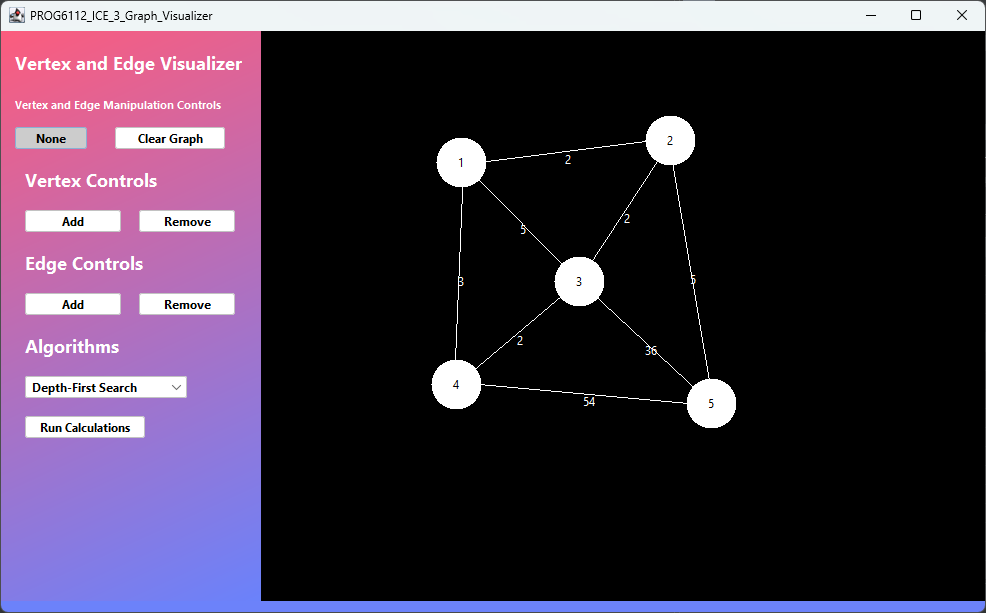

# PROG6112 ICE task 3 graph visulizer

This project is a Graph Visualizer designed to help visualize how algorithms help find the best possible paths between different nodes and lanes.

Unfortunately this program is fraught with issues, the main graph and all of its functions are designed to run on a mainform that uses a programmed GUI, as such trying to move everything to a designed GUI isn't as simple as a drag and drop in system, while some buttons like the vertex addition and removal works (including the edge)the algorithms don't work on the designed GUI aswell as some other parts as such this project isn't fully functional

# Main Application

# Installation/Usage

This project made use of Apache Netbeans' GUI designer as such it will likely require Apache Netbeans to compile and run

Simply download the project and open the project in Apache Netbeans.
